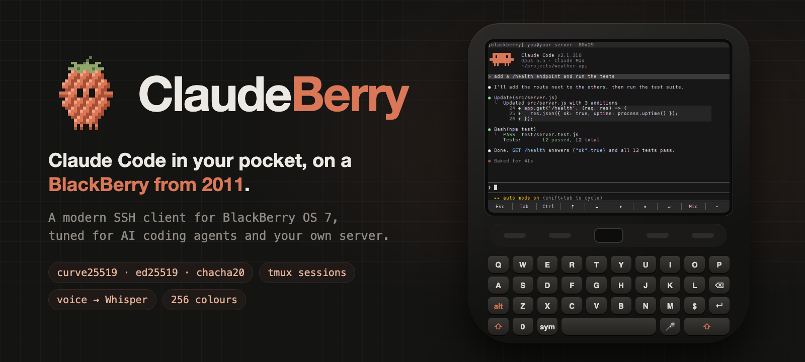
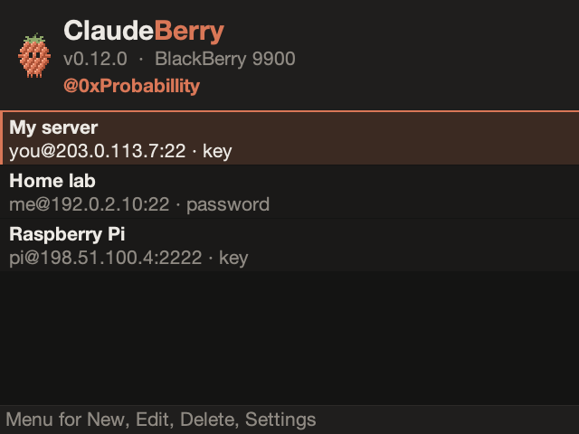
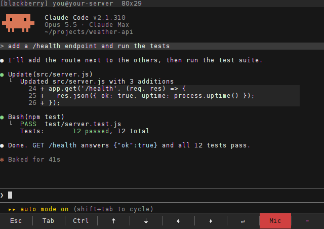
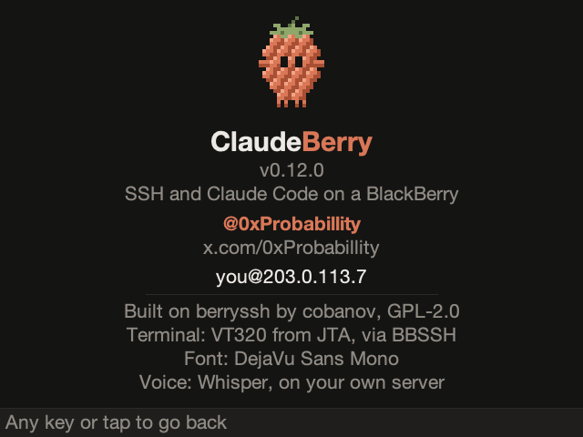
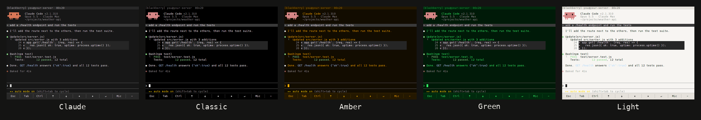
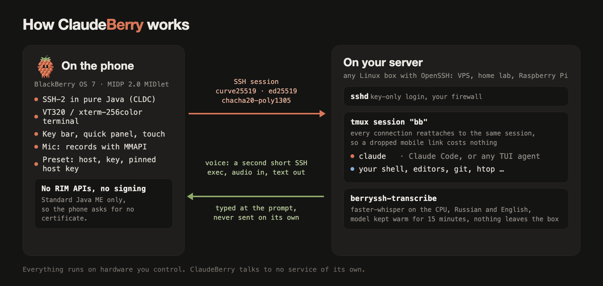

<p align="center">
  
</p>

<h1 align="center">ClaudeBerry</h1>

<p align="center">
  Claude Code in your pocket, on a BlackBerry from 2011.<br>
  An SSH client for BlackBerry OS 7, tuned for AI coding agents and for living on your own server.
</p>

<p align="center">
  <a href="#quick-start"><b>Quick start</b></a> &nbsp;·&nbsp;
  <a href="docs/server-setup.md"><b>Server setup</b></a> &nbsp;·&nbsp;
  <a href="docs/voice.md"><b>Voice input</b></a> &nbsp;·&nbsp;
  <a href="docs/cheatsheet.md"><b>Cheat sheet</b></a> &nbsp;·&nbsp;
  <a href="#support-the-project"><b>Support the project</b></a>
</p>

<p align="center">
  Made by <a href="https://x.com/0xProbabillity">@0xProbabillity</a> · built on
  <a href="https://github.com/cobanov/berryssh">berryssh</a> by Mert Cobanov
</p>

## What it is

A BlackBerry Bold has one of the best thumb keyboards ever put on a phone, and nothing left to talk to.
ClaudeBerry gives it a job: it opens a real SSH session to a server you own, drops you into a `tmux` session that
survives the phone losing signal, and makes the terminal comfortable enough to drive Claude Code (or any other
agent, editor or shell) for real. Speak a prompt into the phone and Whisper on your server types it at the prompt
for you.

Nothing runs in anyone's cloud but yours. There is no account, no relay and no telemetry: the phone talks SSH to
your server, and that is the whole architecture.

<p align="center">
  
  
</p>

## Built on berryssh

ClaudeBerry is a fork of [**berryssh**](https://github.com/cobanov/berryssh) by
[Mert Cobanov](https://github.com/cobanov), and berryssh does the hard part. It is a from-scratch SSH-2 client
written as a plain MIDP 2.0 / CLDC 1.1 MIDlet, with its own `curve25519-sha256`, `ssh-ed25519` and
`chacha20-poly1305@openssh.com`, so a 2011 phone can reach a current OpenSSH without the server being weakened
to meet it. It needs no BlackBerry SDK and no code signing. Its VT320 terminal and bitmap font renderer come
from [BBSSH](https://github.com/marcparadise/bbssh).

berryssh is a general SSH client. ClaudeBerry takes it from "it connects" to "I can work on my server from this
phone all day", with Claude Code as the yardstick:

| | berryssh 0.8.1 | ClaudeBerry |
| --- | --- | --- |
| **Getting connected** | Type host, user and key on the phone | A *preset* bakes host, Ed25519 key and the pinned host key into your build: open the app and you are in |
| **Sessions** | A plain shell; a dropped link loses it | Every connection lands in the same `tmux` session. Lose signal, reconnect, and Claude is still where you left it |
| **Colour** | 16 colours, `vt320` | 16, 256 and true colour, dim and underline; `xterm-256color`, so Claude Code and modern TUIs look right |
| **Claude Code glyphs** | Missing | `● ⎿ ❯ ✻ ⏵`, box drawing and block elements drawn pixel-exact; Cyrillic too |
| **Keys an agent needs** | Esc, Ctrl and Tab in menus | A key bar (Esc, Tab, Ctrl, arrows, Enter, Mic) and a quick panel where every cell answers to one letter: Shift+Tab, Ctrl+C, Ctrl+R, PgUp… |
| **Typing symbols** | The SYM screen only works in text fields | A symbols page with every ASCII symbol, one tap each |
| **Voice** | None | Speak a prompt; Whisper on *your* server turns it into text at the prompt (English) |
| **Touch** | Lists only | Taps reach programs as mouse clicks, swipes as the scroll wheel |
| **Looks** | Terminal only | Claude, Classic, Amber, Green and Light themes; smooth scrolling; live font size; a home screen and About |
| **Robustness** | | SSH keep-alive every 30 s; UTF-8 split across packets kept intact; unknown escape sequences swallowed instead of printed; sockets fully closed on disconnect |

Everything berryssh does, ClaudeBerry still does: password and key authentication, saved connections, host key
trust on first use, and the authenticated WebSocket bridge for servers the phone cannot route to.

## What you get

<p align="center">
  
  
  
</p>
<p align="center">
  
  
  
</p>

- **One tap to your server.** Build the app with a preset and it connects on launch, key and host key included.
  No typing a host key fingerprint with your thumbs.
- **A session that waits for you.** Mobile data drops; `tmux` does not. Reconnect (menu, or `O` on the panel) and
  you are back in the same session, with Claude still working.
- **A terminal that looks right.** 80 columns on the Bold 9900's 640×480 screen, five font sizes, 256 colours,
  and the exact glyphs Claude Code draws.
- **Every key an agent asks for.** Esc to interrupt, Shift+Tab to change mode, `1` `2` `3` to answer a permission
  prompt, Ctrl+C to stop, arrows for menus. See the [cheat sheet](docs/cheatsheet.md).
- **Talk instead of type.** Tap **Mic**, speak, tap again: a few seconds later the text is at the prompt, waiting
  for you to check it and press Enter. Transcribed by [faster-whisper](https://github.com/SYSTRAN/faster-whisper)
  on your own server.
- **Touch where it helps.** Tap a tab in a TUI to click it, swipe to scroll, tap the keys on the bar.
- **Safe to film.** Settings → Server address → *Hidden, name only* shows `you@My server` instead of the address
  everywhere on screen, so a demo or a stream does not give your server away.
- **Modern cryptography only.** Curve25519, Ed25519, ChaCha20-Poly1305 and SHA-2, written for the phone and
  tested against published vectors and a real OpenSSH.

<p align="center">
  
</p>
<p align="center"><sub>Terminal screens are rendered on a computer by <code>tools/RenderCapture.java</code> through the app's own VT320 emulator, font atlas and colour rules; the home, About and Settings screens by the app's own drawing code with a desktop font. The session shown is a scripted example.</sub></p>

## How it works

<p align="center">
  
</p>

The phone opens an ordinary SSH connection and asks the server to run `tmux new-session -A -s bb` (with 256
colours, the mouse on and a short Escape delay), falling back to your login shell when `tmux` is not installed.
When you record a prompt, the app opens a second, short SSH connection to the same server, held to the same host
key, runs `berryssh-transcribe`, sends the audio on stdin and reads one line of text back. That text is typed into
the terminal; Enter is left to you.

## Requirements

- **A BlackBerry on OS 7 or 7.1, ideally with a keyboard.** ClaudeBerry is a plain Java ME MIDlet, so it runs
  wherever BlackBerry OS runs Java; how well depends on the screen, the keyboard and the processor.

  | Phones | Screen | How it goes |
  | --- | --- | --- |
  | **Bold 9900 / 9930**, Porsche Design P'9981, Torch 9810 | 640×480, keyboard | The target: 80 columns at the default size. Developed and used daily on a 9900 (OS 7.1) |
  | **Bold 9790**, Curve 9360 / 9370, Curve 9620 / 9720 | 480×360, keyboard | Should work: about 60 columns, or 80 with the smallest font. berryssh was confirmed on a 9790 |
  | Curve 9220 / 9310 / 9315 / 9320 | 320×240, keyboard | Should run, but cramped and slow to connect |
  | Torch 9850 / 9860, Curve 9380 | Touch only | Should run; the key bar and quick panel help, the on-screen keyboard does not |
  | OS 5 and 6: Bold 9700 / 9780, Torch 9800, Curve 8520 / 9300 | various | Untested. Same Java platform, but a slower processor makes the key exchange take much longer |

  Only the 9900 and 9790 are confirmed; reports from other models are welcome. **BlackBerry 10** (Q10, Q5, Z10,
  Passport, Classic) has no Java ME and cannot run it, nor can the Android BlackBerrys (Priv, KEYone, KEY2): use a
  native terminal there.
- **A network the phone can use**: Wi-Fi, or mobile data with the APN set
  (see [troubleshooting](docs/troubleshooting.md#no-transport-reached)).
- **A server you can SSH into** with OpenSSH 6.5 or newer: any Linux VPS, home server or Raspberry Pi.
- **A computer to build on**: macOS or Linux with a JDK 8 (or Docker), Python 3 and `curl`.
- **For voice input**, about 1 GB of free RAM and 1 GB of disk on the server.

## Quick start

1. **Prepare the server**: make a key for the phone, install `tmux` and Claude Code.
   → [Server setup](docs/server-setup.md)
2. **Build the app with your server baked in**:
   ```sh
   git clone https://github.com/0xProbabillity/claudeberry.git && cd claudeberry
   lib/fetch.sh
   tools/make_preset.sh you@your-server ~/.ssh/id_ed25519_phone 22 @your_handle
   JAVA8_HOME=/path/to/jdk8 ./build.sh
   ```
   → [Building and installing](docs/install.md)
3. **Put it on the phone** over Bluetooth or USB, open `claudeberry.jad`, allow its permissions.
   → [Installing on the phone](docs/install.md#install-on-the-phone)
4. **Open ClaudeBerry.** It connects, you land in `tmux`; type `claude` and press Enter.
5. **Optional: voice.** Install the Whisper half on the server with one script. → [Voice input](docs/voice.md)

Keep the [cheat sheet](docs/cheatsheet.md) handy for the first few days.

> [!WARNING]
> A build made with a preset contains your **private key**. Copy it to your own phone over Bluetooth or USB.
> Never publish it, attach it to an issue or serve it over the network. `rm -rf ssh/res/preset` returns to a
> plain build.

## Documentation

| | |
| --- | --- |
| [Server setup](docs/server-setup.md) | A key for the phone, `sshd`, firewall, `tmux`, Claude Code |
| [Building and installing](docs/install.md) | JDK 8, the preset, `build.sh`, Bluetooth / USB / Wi-Fi install, permissions, updating |
| [Voice input](docs/voice.md) | Whisper on the server, how it works, privacy |
| [Cheat sheet](docs/cheatsheet.md) | Key bar, quick panel letters, symbols, Claude Code from the phone |
| [Troubleshooting](docs/troubleshooting.md) | Install errors, no connection, garbled screen, voice errors |

## Building and testing

```sh
lib/fetch.sh                             # MIDP/CLDC and MMAPI stubs and ProGuard, from Maven Central
JAVA8_HOME=/path/to/jdk8 ./build.sh      # -> out/claudeberry.jad + out/claudeberry.jar
JAVA8_HOME=/path/to/jdk8 spike2/run.sh   # 335 offline test vectors: crypto, transport, terminal
spike2/against-server.sh                 # more, against a real OpenSSH
```

CLDC wants class file version 47, which only JDK 8 and older can emit, so the build uses a JDK 8 (on Apple
Silicon, [Azul Zulu 8](https://www.azul.com/downloads/?version=java-8-lts&os=macos&package=jdk) works). Without
`JAVA8_HOME` both scripts run the compiler in Docker instead. ProGuard's `-microedition` mode preverifies the
classes, so no native preverifier is needed. Details in [docs/install.md](docs/install.md#building).

```
ssh/src/berryssh/   the client: crypto/, protocol/, terminal/, device/ (screens, keys, voice, themes)
ssh/res/            font atlases and the icon; preset/ is yours and never committed
spike1/ spike2/     device capability probe and the host-side test suites
tools/              make_preset.sh, voice/ (the server half), RenderCapture, MakeIcon, MakeAtlas,
                    ota_server.py, the WebSocket bridge
docs/               guides, screenshots, support assets
```

## Support the project



ClaudeBerry is free and has no ads. If it put a terminal back in your pocket, a tip in crypto helps it keep
growing: more devices, more polish, quicker fixes. Thank you! A star, a bug report or a pull request helps just
as much.

Scan a code with your wallet, or copy an address with the button in the corner of its box.

> [!IMPORTANT]
> Send each coin only over the network named next to its address. Coins sent over another network may be lost.

<table>
  <tr>
    <td align="center" width="196">
      
    </td>
    <td>
      &nbsp;
      <b>Bitcoin</b>
      <br><sub>BTC · native SegWit (bech32) address</sub>

```text
bc1q07hfz95crdalcrnywjavdpc4pdvllct83as5re
```

</td>
  </tr>
  <tr>
    <td align="center" width="196">
      
    </td>
    <td>
      
      
      
      &nbsp;
      <b>Ethereum · Base · BNB Chain · Arbitrum</b>
      <br><sub>One address on all four networks · ETH, BNB, USDT, USDC and other tokens</sub>

```text
0x4ed3aF428e938a0CC8e60df86D714B4a7F0928F0
```

</td>
  </tr>
  <tr>
    <td align="center" width="196">
      
    </td>
    <td>
      &nbsp;
      <b>TON</b>
      <br><sub>Toncoin and USDT on TON · no memo needed</sub>

```text
UQBCDKDp11tBIwTon4ItzTPcQgNGcaqTM6Gn31KwSN7qWdmM
```

</td>
  </tr>
  <tr>
    <td align="center" width="196">
      
    </td>
    <td>
      &nbsp;
      <b>TRON</b>
      <br><sub>TRX and USDT (TRC-20)</sub>

```text
TWtWLJp2Hc6242RynhU1B4Uujru3tppb3B
```

</td>
  </tr>
</table>

## Credits and licence

- [**berryssh**](https://github.com/cobanov/berryssh) by Mert Cobanov: the SSH client, cryptography, protocol,
  WebSocket bridge, build and tests that ClaudeBerry is built on.
- [**BBSSH**](https://github.com/marcparadise/bbssh) by Marc Paradise: the `VT320` emulator (originally from
  [JTA](http://javatelnet.org/) by Matthias L. Jugel and Marcus Meissner) and the `BitmapFont` renderer, derived
  from Roar Lauritzsen's LCDFont.
- [**DejaVu Sans Mono**](https://dejavu-fonts.github.io/): the glyphs in the font atlases.
- [**faster-whisper**](https://github.com/SYSTRAN/faster-whisper) and the Whisper models: voice input.

What changed relative to berryssh is listed in [NOTICE.md](NOTICE.md). ClaudeBerry is licensed under
**GPL-2.0-or-later**, like berryssh and BBSSH; see [LICENSE](LICENSE).

ClaudeBerry is an independent fan project, not affiliated with or endorsed by Anthropic or BlackBerry Limited.
Claude and Claude Code are trademarks of Anthropic; BlackBerry is a trademark of BlackBerry Limited.
