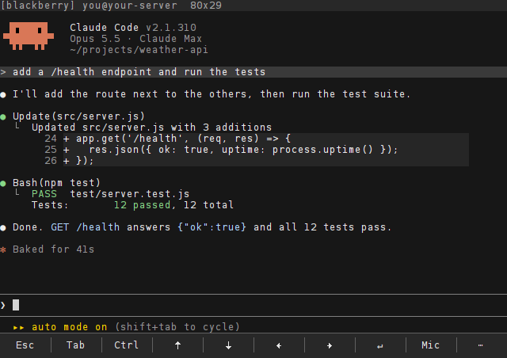
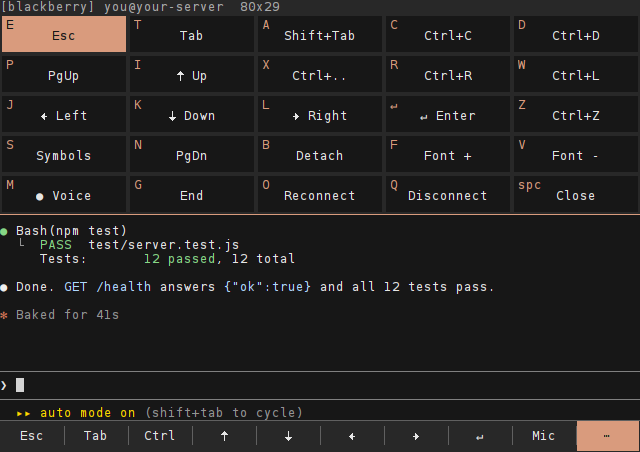
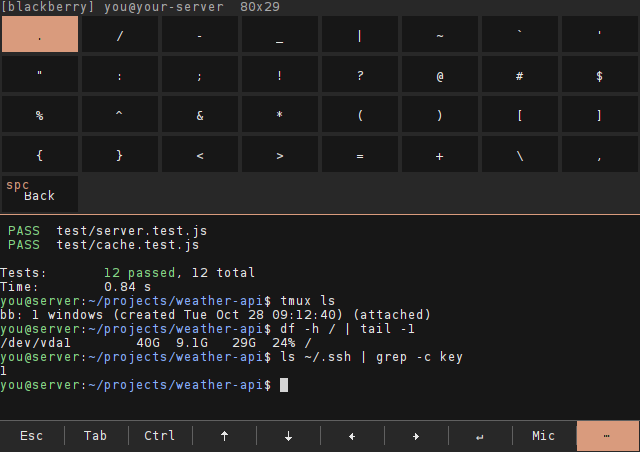
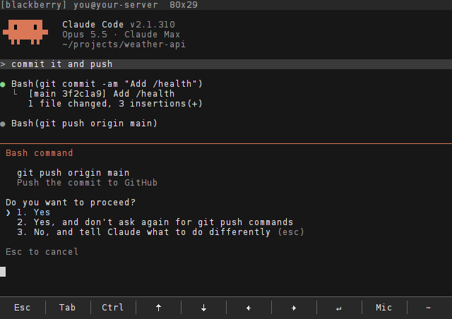
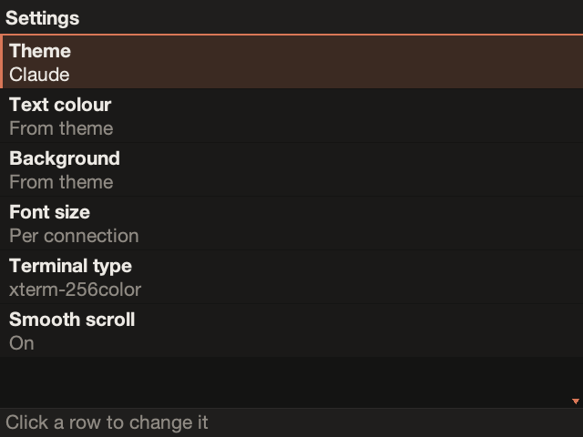

# ClaudeBerry cheat sheet

Everything you press, on one page. Written for a Bold 9900; other OS 7 phones differ only in where the symbols
sit on the keys.

- [Starting](#starting)
- [The key bar](#the-key-bar)
- [The quick panel `⋯`](#the-quick-panel-)
- [Symbols](#symbols)
- [Voice](#voice)
- [Claude Code from the phone](#claude-code-from-the-phone)
- [Touch](#touch)
- [The BlackBerry menu](#the-blackberry-menu)
- [Settings](#settings)
- [tmux in one minute](#tmux-in-one-minute)

## Starting

- Open **ClaudeBerry**. With a preset it connects by itself; otherwise click a connection.
- You land in the **tmux session `bb`**. If the connection drops and you reconnect, or you quit and open the app
  again, you are back in the same session. Whatever was running there kept running.
- Start Claude Code: `claude` and Enter. `claude --continue` picks up the last conversation in that folder.

## The key bar

| Key | Does |
| --- | --- |
| `Esc` | Escape. In Claude Code: interrupt the answer, close a menu or dialog |
| `Tab` | Tab: completion |
| `Ctrl` | The next letter is sent with Ctrl (`Ctrl`, then `c` = Ctrl+C) |
| `↑` `↓` `←` `→` | Arrows: history, menus, Claude's choices |
| `↵` | Enter |
| `Mic` | Voice input: tap to record, tap again to stop ([below](#voice)) |
| `⋯` | The quick panel |

Turn the bar off in **Settings → Key bar** for one more row of terminal.

## The quick panel `⋯`

Open it with `⋯` on the bar, or **Menu → Quick keys**. Each cell has a letter in its corner: **while the panel is
open, pressing that letter on the keyboard does the same as tapping the cell.** The panel stays open, so `K` `K`
`↵` moves down twice and confirms.

| Letter | Key | | Letter | Key |
| --- | --- | --- | --- | --- |
| `E` | Esc | | `I` | ↑ Up |
| `T` | Tab | | `K` | ↓ Down |
| `A` | **Shift+Tab** (Claude's mode) | | `J` | ← Left |
| `C` | **Ctrl+C** (stop) | | `L` | → Right |
| `D` | Ctrl+D (end of input, exit) | | `Enter` | Enter |
| `R` | Ctrl+R (search history) | | `P` / `N` | Page Up / Page Down |
| `W` | Ctrl+L (redraw the screen) | | `G` | End |
| `Z` | Ctrl+Z (suspend) | | `S` | **Symbols** page |
| `X` | Ctrl + the next key | | `M` | **Voice** |
| `B` | Detach from tmux (it keeps running) | | `F` / `V` | Font bigger / smaller |
| `O` | **Reconnect** | | `Q` | Disconnect |
| `Space` | Close the panel | | | |

The trackpad moves the highlight and clicking it presses the cell. **Del** or the **Back** key also close the
panel.

## Symbols

**Quick panel → `S`** shows every ASCII symbol as a big cell: `. / - _ | ~ ` ' " : ; ! ? @ # $ % ^ & * ( ) [ ] { }
< > = + \ ,` One tap types it. The keyboard types normally on this page; **Space** or **Del** goes back.

The symbols printed on the keys are typed with **alt + key**. On a 9900 (check your own keys):

| alt + | | alt + | | alt + | |
| --- | --- | --- | --- | --- | --- |
| `M` | `.` | `N` | `,` | `G` | `/` |
| `I` | `-` | `U` | `_` | `O` | `+` |
| `H` | `:` | `J` | `;` | `K` | `'` |
| `L` | `"` | `V` | `?` | `B` | `!` |
| `P` | `@` | `Q` | `#` | `A` | `*` |
| `T` / `Y` | `(` / `)` | `W` `E` `R` | `1` `2` `3` | `S` `D` `F` | `4` `5` `6` |
| `Z` `X` `C` | `7` `8` `9` | | | | |

The **sym** key does nothing in the terminal: its symbol screen only works in text fields. Use the symbols page.

If a key behaves strangely, **Menu → Key codes** shows the code of every key you press at the bottom of the
screen; include it in a bug report.

## Voice

1. Tap **Mic** (or panel → `M`). It turns **red** and counts seconds: recording.
2. Speak your prompt, in English.
3. Tap **Mic** again. It turns **orange with a spinner** while the server transcribes; the status line shows the
   stage. After ~5 s the text is at the prompt.
4. Check it, press **Enter**. Enter is never pressed for you.

Server setup: [voice.md](voice.md).

## Claude Code from the phone

| To | Press |
| --- | --- |
| Answer a permission prompt | The option's digit: `1` (alt+W), `2` (alt+E), `3` (alt+R). Or `↓` and `↵` |
| Interrupt Claude mid-answer | `Esc` |
| Switch mode (normal / auto-accept / plan) | **Shift+Tab**: panel → `A` |
| Open the command menu | `/` at the start of the line (alt+G), then `↑` `↓` `↵` |
| Go back in your prompt history | `↑` on an empty prompt |
| Search history | Ctrl+R: panel → `R` |
| Quit Claude Code | `Ctrl+C` twice, or `/exit` |
| Leave it working and put the phone away | Just put it away, or panel → `B` (detach). Reconnect later: it is still there |
| Repaint a garbled screen | Ctrl+L: panel → `W` |

A newline inside a prompt: type `\` and then Enter.

## Touch

| Gesture | Does |
| --- | --- |
| Tap the text | A mouse click at that spot, when the program wants the mouse (tabs and buttons in TUIs) |
| Swipe up / down | The scroll wheel. In a plain tmux shell this enters copy mode to scroll back; `q` or `Esc` leaves it |
| Tap a key on the bar or a cell on the panel | Presses it |
| Tap a row in a list | Opens it |

## The BlackBerry menu

The **BlackBerry key** (the one with the logo) opens the menu.

**In a session**: Quick keys, Ctrl, Font +, Font −, Esc, Page up, Page down, Full screen, Reconnect, Disconnect,
Quit, Key codes.

**On the home screen**: Connect, New, Edit, Delete, **Settings**, **About**, Quit.

- **Disconnect** closes the connection and returns to the list. tmux, and Claude in it, keep running on the
  server.
- **Quit** leaves the app. Same as above: the server side keeps running.
- To really end the session on the server, type `exit` in each tmux window (or Ctrl+D in an empty shell).

## Settings

**Home screen → Menu → Settings.** Click a row to step to its next value; it is saved at once.

| Row | Values |
| --- | --- |
| Theme | Claude, Classic, Amber, Green, Light |
| Text colour | From theme, White, Light grey, Grey, Claude orange, Amber, Green, Cyan, Black |
| Background | From theme, Black, Claude dark, Graphite, Navy, Dark green, Dark brown, White |
| Font size | Per connection, or one size for all: 6×9, 6×11, 8×14, 10×18, 12×21 |
| Terminal type | `xterm-256color` (colours for Claude Code and modern tools) or `vt320` |
| Smooth scroll | Scrolling slides instead of jumping |
| Key bar | The bar of keys along the bottom |
| Session | tmux (reconnects to the same session) or Plain shell |
| Voice language | English |

`Font +` / `Font −` (menu, or panel → `F` / `V`) change the size live in a session.

## tmux in one minute

ClaudeBerry runs tmux for you; these are the few commands worth knowing. The prefix is **Ctrl+B**: press `Ctrl`
on the bar, then `b`, then the key.

| Keys | Does |
| --- | --- |
| Ctrl+B `c` | New window (a second shell next to Claude) |
| Ctrl+B `n` / `p` | Next / previous window |
| Ctrl+B `d` | Detach (panel → `B` does this in one tap) |
| Ctrl+B `[` | Scroll back; `q` to leave |
| `tmux ls` | List sessions |
