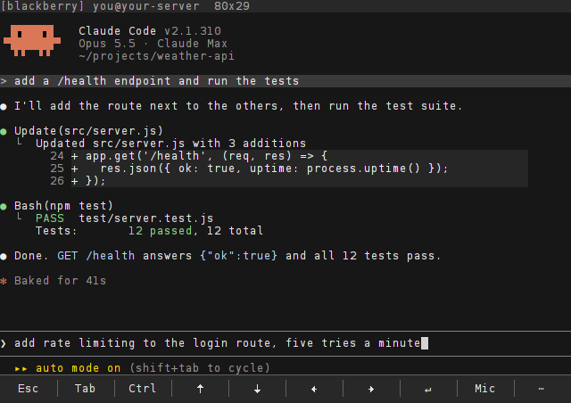

# Voice input

Tap **Mic**, say your prompt, tap **Mic** again. A few seconds later the words are typed at the prompt in the
terminal, and you press Enter when they look right. Speech recognition runs on **your own server** with
[faster-whisper](https://github.com/SYSTRAN/faster-whisper), an efficient implementation of OpenAI's Whisper
models: no cloud service, no API key, no account.

<p align="center">
  
  
</p>

- [Install the server half](#install-the-server-half)
- [Use it](#use-it)
- [Language](#language)
- [Choosing a model](#choosing-a-model)
- [How it works](#how-it-works)
- [Privacy](#privacy)
- [Uninstall](#uninstall)

## Install the server half

The server needs `ffmpeg` (to decode the phone's recording) and [`uv`](https://docs.astral.sh/uv/) (to set up an
isolated Python with faster-whisper). Python itself is fetched by `uv` if the server does not have 3.10.

On the server:

```sh
sudo apt install ffmpeg
curl -LsSf https://astral.sh/uv/install.sh | sh     # installs uv into ~/.local/bin
```

From your clone of the repository, on your computer:

```sh
scp tools/voice/transcribe.py tools/voice/install.sh you@your-server:/tmp/
ssh you@your-server 'sudo env "PATH=$PATH" bash /tmp/install.sh'
```

(`env "PATH=$PATH"` lets `sudo` find the `uv` you just installed. Logged in as `root`, plain
`bash /tmp/install.sh` is enough.)

`install.sh` changes nothing system-wide except two paths:

| Path | What |
| --- | --- |
| `/opt/berryssh-voice/` | A virtualenv with faster-whisper, and `transcribe.py` |
| `/usr/local/bin/berryssh-transcribe` | A two-line wrapper, the command the phone runs |

The command keeps berryssh's name because the voice protocol is shared with it.

**Test it** from your computer with any short recording of your voice (WAV, MP3, M4A, AMR, anything `ffmpeg`
reads):

```sh
ssh you@your-server 'berryssh-transcribe audio/x-wav auto' < hello.wav
```

```
OK Hello from my BlackBerry.
```

The first run downloads the `small` model (about 500 MB, into `~/.cache/huggingface` of the user the phone logs
in as) and takes a minute. After that, a phrase takes a few seconds.

## Use it

1. Tap **Mic** on the key bar (or open the quick panel with `⋯` and press `M`). The key turns red: the phone is
   recording. The first time, BlackBerry asks for permission to record; allow it.
2. Say your prompt.
3. Tap **Mic** again. After about 5 seconds (10–15 s if it has not been used for a while) the text appears at the
   prompt.
4. Read it, fix it if needed, press **Enter**.

Enter is never pressed for you, so a misheard word cannot reach Claude by itself.

## Language

Voice input understands **English**. The app asks the server for English, and the server's script fixes
Whisper to it, which is what makes short phrases reliable: left to choose among all 99 of its languages, Whisper
sometimes hears another one in a few mumbled words.

## Choosing a model

The model is set by an environment variable in the wrapper. `small` is a good balance on a 2-4 core VPS:

| Model | Download | RAM | Speed on a small VPS | Quality |
| --- | --- | --- | --- | --- |
| `base` | 150 MB | ~0.5 GB | fastest | fine for clear English |
| `small` (default) | 500 MB | ~1 GB | a few seconds per phrase | good |
| `medium` | 1.5 GB | ~2.5 GB | slower | better with accents and noise |

To change it, edit `/usr/local/bin/berryssh-transcribe`:

```sh
#!/bin/sh
export BERRYSSH_WHISPER_MODEL=medium
exec /opt/berryssh-voice/venv/bin/python /opt/berryssh-voice/transcribe.py "$@"
```

and stop the warm model so the next request loads the new one: `pkill -f 'transcribe.py --serve'`.

## How it works

1. The phone records with the standard Java ME media API (MMAPI), trying the formats the phone says it supports
   (usually AMR) before common guesses.
2. It opens a **second, short SSH connection** to the same server, with the same key, and refuses to continue if
   the server's host key differs from the session's.
3. It runs `berryssh-transcribe <content-type> <language> <rate>` and writes the recording to its stdin.
4. `transcribe.py` converts the audio to 16 kHz WAV with `ffmpeg` and transcribes it. It answers with one line:
   `OK <text>` or `ERR <what went wrong>`.
5. The phone types the text into the terminal, without Enter.

Loading a Whisper model takes longer than transcribing a phrase, so the first request leaves a small server
behind that keeps the model in memory, listening on a Unix socket only its user can open
(`/tmp/berryssh-voice.sock`, mode 600). Later requests go to it. It exits by itself after 15 minutes without a
request, and the memory goes with it.

## Privacy

The audio goes from the phone to your server over SSH, and nowhere else. It is written to a temporary directory
for `ffmpeg` and deleted as soon as it is decoded. The model runs on the server's CPU; the only download is the
model itself, from Hugging Face, once.

## Uninstall

```sh
sudo rm -rf /opt/berryssh-voice /usr/local/bin/berryssh-transcribe
rm -rf ~/.cache/huggingface/hub/models--Systran--faster-whisper-*
```

If something does not work, see [troubleshooting](troubleshooting.md#voice-input).
